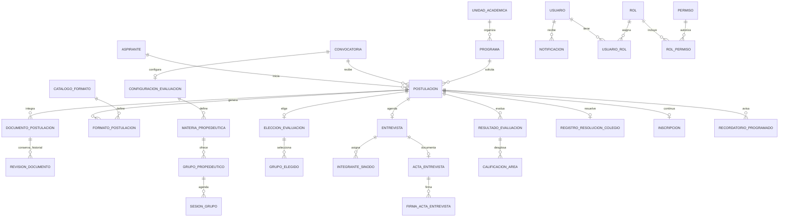

# Modelo de datos de SIGAP

El modelo relacional se alinea con el flujo de admisión vigente en `sigap-frontend`. Las respuestas variables del registro y los bloques variables de los formatos se guardan en JSON; las entidades que necesitan relaciones, búsquedas, historial y restricciones tienen tablas propias.

## Relaciones principales

## Decisiones relevantes

- **Registro e identidad:** `Aspirante` contiene identidad, contacto, CURP e ID temporal; `Postulacion` relaciona al aspirante con convocatoria y programa. `respuestasRegistro` conserva las respuestas cambiantes del wizard.
- **Convocatorias A/B:** cada convocatoria guarda ventana de registro, límite de archivo y calendario publicado. `ConfiguracionEvaluacion` separa las fechas y modalidad del propedéutico, examen, materias, grupos, docentes y sesiones. El estado Abierta/Próxima/Cerrada debe calcularse a partir de las fechas.
- **Documentos:** `CatalogoDocumento`, `DocumentoPostulacion` y `RevisionDocumento` separan los requisitos del archivo entregado y su historial. Se registran observaciones y prórrogas; la regla para que el aspirante reemplace únicamente documentos observados se valida en el servicio.
- **Formatos SIP/MTC:** `CatalogoFormato` define cada formato, su fase, destino, plantilla y configuración de campos; `FormatoPostulacion` conserva capturas, PDF generado, PDF firmado y estado por postulación.
- **Entrevista MTC-EC:** `Entrevista`, `IntegranteSinodo`, `ActaEntrevista` y `FirmaActaEntrevista` conservan fecha, modalidad, sala, publicación, integrantes, criterios, resolución y firmas.
- **Evaluación:** `EleccionEvaluacion` guarda modalidad y segunda oportunidad; `GrupoElegido` guarda un grupo por materia. `ResultadoEvaluacion` y `CalificacionArea` separan propedéutico/examen y las notas de Matemáticas y Programación, con profesor, fecha de captura y publicación.
- **Resolución e inscripción:** `RegistroResolucionColegio` representa la resolución publicada por Posgrado. `Inscripcion` es el proceso posterior de UTEyCV y guarda dedicación, firmas SIP, publicación del SIP-08, SICEP y formalización.
- **Cuentas y comunicaciones:** `Usuario`, `Rol`, `Permiso` y tablas de unión implementan permisos por área. `Aviso`, `Comunicado` y `Notificacion` persisten comunicaciones y estado de lectura/envío.
- **Recordatorios:** `RecordatorioProgramado` registra cada tipo por postulación y canal, con clave idempotente, hora programada, estado, intentos y errores de entrega.

## Reglas que requieren lógica de servicio

1. Rechazar selecciones de grupos con choques de horario y comprobar que cada grupo pertenece a la materia seleccionada.
2. Programar hasta tres recordatorios del examen: una semana antes, un día antes y el mismo día a las 07:00. Los dos primeros solo se generan si aún son posteriores a la elección. Para entrevista: un día y una hora antes. Usar una zona horaria institucional consistente.
3. Aplicar la calificación mínima configurada para la convocatoria; integrar promedio y acreditación solo cuando se hayan capturado todas las áreas requeridas.
4. Habilitar la segunda oportunidad solo para las áreas no acreditadas del propedéutico y respetar la decisión registrada del aspirante.
5. No aplicar/publicar el dictamen de entrevista hasta que haya tres integrantes válidos y las tres firmas requeridas. Prisma no impone por sí solo esta regla de negocio.
6. Cancelar y regenerar los recordatorios pendientes si cambia la fecha del evento; conservar el historial de los ya enviados.
7. Ejecutar cambios de estado y bitácora en transacciones. El envío real de correo/notificaciones requiere un trabajador/cola; el estado simulado en `localStorage` del frontend no acredita entrega.

Los binarios deben guardarse en almacenamiento de archivos y en PostgreSQL solo sus URL y metadatos. Antes de usar datos reales deben confirmarse los catálogos oficiales, la política de retención, la zona horaria y la matriz institucional de permisos.
