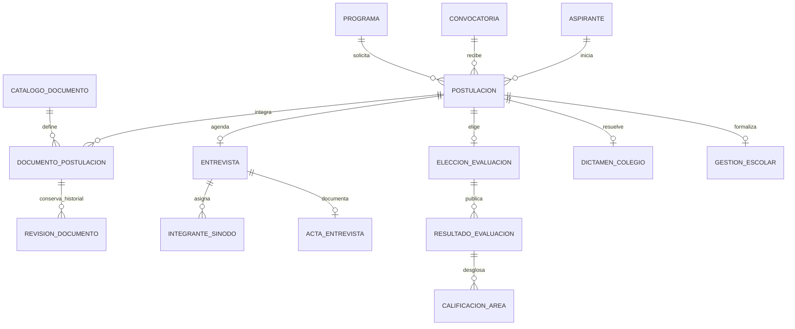

# Modelo de datos inicial

El modelo se obtuvo leyendo el flujo actual del frontend. Mantiene las respuestas variables del formulario y normaliza la información que necesita relaciones, historial y validaciones.

## Relaciones principales

## Correspondencia con el frontend

| Flujo visible | Modelos principales | Decisión de persistencia |
|---|---|---|
| Formulario de registro (`RegistroWizard`, `registro-form.ts`) | `Aspirante`, `Postulacion`, `Convocatoria`, `Programa`, `UnidadAcademica` | Contacto e identidad van en `Aspirante`; programa/semestre y respuestas del cuestionario se guardan por postulación. `respuestasRegistro` es JSON para acomodar preguntas dinámicas. |
| Convocatorias y calendario | `Convocatoria`, `Grupo`, `SesionGrupo` | Ventana de registro, semestre y límite de archivo por convocatoria; horarios de cada grupo como filas consultables. |
| Expediente y validación documental | `CatalogoDocumento`, `DocumentoPostulacion`, `RevisionDocumento` | Un registro vigente por documento requerido y postulación. Cada dictamen de revisión se conserva con usuario, estado, observación y prórroga. |
| Entrevista MTC-EC | `Entrevista`, `Profesor`, `IntegranteSinodo`, `ActaEntrevista` | La cita se relaciona 1:1 con postulación. El sínodo y sus firmas son filas aparte. Respuestas/campos variables del acta y criterios se conservan como JSON. |
| Propedéutico y examen | `EleccionEvaluacion`, `Materia`, `Grupo`, `EleccionGrupo`, `ResultadoEvaluacion`, `CalificacionArea`, `SegundaOportunidad` | Modalidad y grupos elegidos se relacionan con el aspirante; resultados separados por evaluación y calificaciones por área/profesor. La fecha de publicación diferencia captura de resultado visible. |
| Dictamen SIP-04 e inscripción | `DictamenColegio`, `GestionEscolar`, `CatalogoFormato`, `FormatoPostulacion` | El dictamen, su publicación y los formatos firmados tienen fechas y metadatos auditables; SICEP es único cuando se asigna. |
| Roles, avisos y administración | `Usuario`, `Rol`, `Permiso`, `UsuarioRol`, `RolPermiso`, `Aviso`, `Comunicado`, `Notificacion`, `EventoBitacora` | Permisos por área; avisos/notificaciones por expediente y bitácora append-only a nivel de aplicación. |

## Reglas que requieren lógica de servicio

- La entrevista debe tener exactamente tres integrantes con colegiatura vigente. Tras las tres firmas del sínodo se registra el dictamen del acta.
- La etapa siguiente depende de la validación documental, resultado de entrevista y publicación de resultados. No se debe permitir cambiarla sin comprobar esos requisitos.
- El resultado integrado debe calcular el promedio y acreditar todas las áreas aplicables; la calificación mínima pertenece a la convocatoria.
- El archivo se acepta según tipo y límite de la convocatoria. PostgreSQL guarda URL y metadatos; carga, antivirus, acceso y retención del binario corresponden al proveedor de almacenamiento.
- La bitácora debe escribirse en la misma operación de negocio que cambia el estado, idealmente dentro de una transacción Prisma.

Los datos del frontend que hoy son listas fijas (unidades, áreas, materias, criterios del MTC-EC y catálogo documental) deben cargarse como catálogos y revisarse con Posgrado/UTEyCV antes de habilitar captura real. El esquema inicial prioriza el flujo que ya existe; no reemplaza la revisión institucional de privacidad y reglas académicas.
